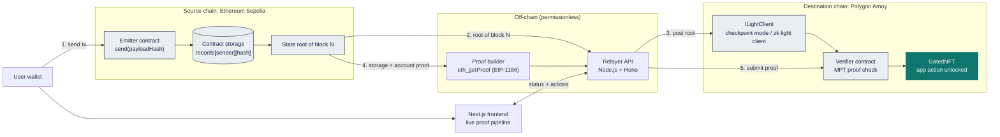
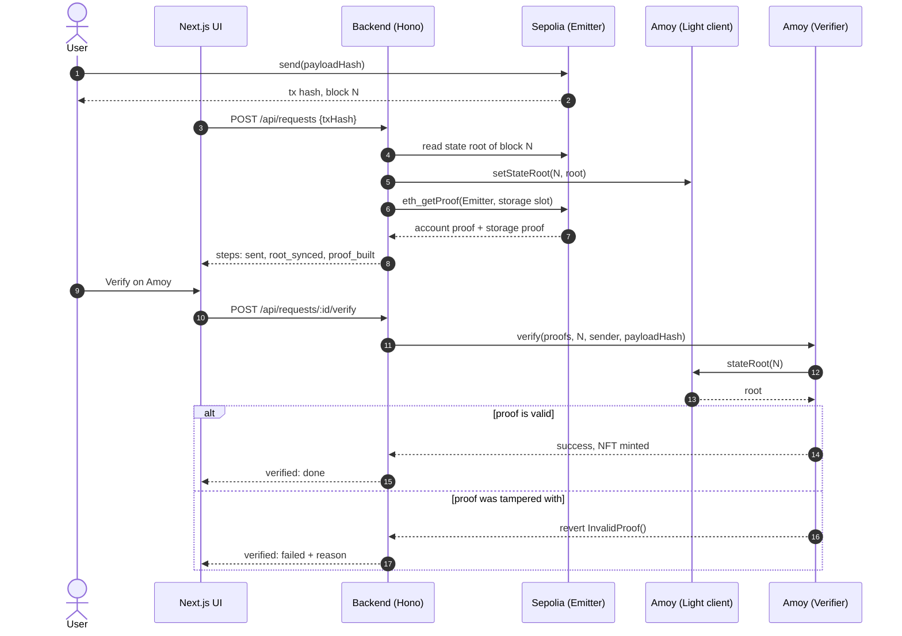
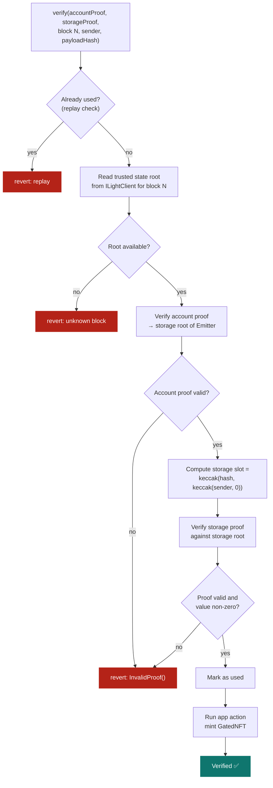
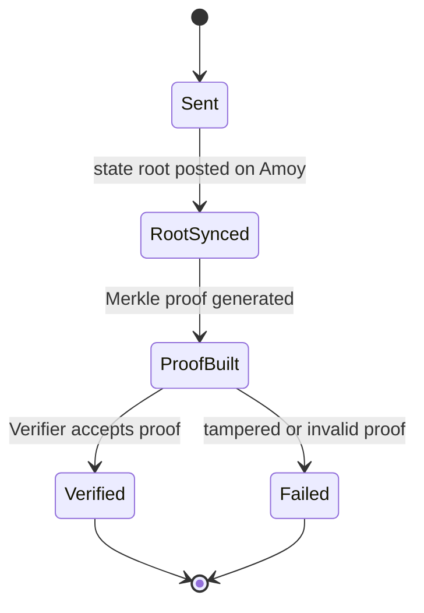

<p align="center">
  
</p>

<p align="center">
  <b>Prove a transaction on one blockchain. Use it on another. No bridge operator to trust.</b>
</p>

<p align="center">
  
  
  
  
  
  
  
  
</p>

<p align="center">
  <a href="#-the-problem">Problem</a> ·
  <a href="#-how-it-works">How it works</a> ·
  <a href="#-architecture">Architecture</a> ·
  <a href="#-tech-stack">Tech stack</a> ·
  <a href="#-getting-started">Getting started</a> ·
  <a href="#-security-model">Security</a> ·
  <a href="#-roadmap">Roadmap</a>
</p>

---

## 🚨 The problem

Blockchains such as Ethereum, Polygon, Solana and Avalanche each keep their own state, consensus and execution environment. A smart contract on one chain **cannot natively check** what happened on another.

Existing solutions rely on centralized bridges, relayers and multisig wallets. Those add cost and delay, and every one of them is a single point of failure. In June 2022 the Horizon bridge lost about **$100M** after compromised keys on a small multisig.

**Goal:** let a user start a transaction on one chain and have another chain verify it directly, with no trusted intermediary and no changes to either blockchain's protocol.

## ✅ Our solution

ProofLink replaces trust in people with verification of math.

| Traditional bridge | ProofLink |
|---|---|
| Trust a multisig or relayer committee | Trust only cryptographic proofs |
| Relayer can steal or censor | Relayer can only deliver data, not forge it |
| Keys are a single point of failure | No privileged keys in the proof path |
| Needs chain-specific trust assumptions | Pluggable light client interface |

## ⚙️ How it works

1. **Send.** The user calls `Emitter.send(payloadHash)` on the source chain. The contract stores a record and emits an event.
2. **Sync trusted root.** A state root of the source chain is made available on the destination chain through the `ILightClient` interface (checkpoint mode today, zk light client next).
3. **Build proof.** A prover calls `eth_getProof` (EIP-1186) and gets a Merkle-Patricia proof that the user's record exists under that root.
4. **Verify on-chain.** The destination `Verifier` contract checks the account proof and the storage proof against the trusted root. If it passes, the app action runs (here, minting an NFT). If anything was changed, the call reverts with `InvalidProof()`.

> Anyone can act as the relayer. A fake or tampered proof fails the math, so relaying needs no trust.

## 🗺️ Architecture

> 🔍 **Zoom:** GitHub renders the diagrams below with built-in pan and zoom controls. Hover a diagram and use the **+ / − / arrow** buttons, or open the file in [mermaid.live](https://mermaid.live) for a full-screen view.

### System overview



### Request lifecycle



### Verification logic inside the `Verifier`



### Request states (as shown in the UI)



## 🧰 Tech stack

| Layer | Technology | Purpose |
|---|---|---|
| Smart contracts | Solidity, Foundry | `Emitter`, `Verifier`, light client, demo NFT, tests |
| Proof builder and relayer | TypeScript, Node.js, Hono, viem | Builds EIP-1186 proofs, posts roots, submits proofs |
| Light client | Checkpoint mode now; SP1 zk light client planned | Supplies the trusted source-chain state root |
| Frontend | Next.js, TypeScript, Tailwind CSS, viem | Wallet connect and live proof pipeline |
| Infrastructure | Alchemy or Infura RPC, Vercel | Chain access and hosting |

## 📁 Project structure

```text
ProofLink/
├─ assets/              logo and README images
├─ app/                 Next.js app (UI)
├─ lib/                 API client with mock mode
├─ contracts/           Foundry project: Emitter, LightClient, Verifier, GatedNFT
├─ backend/             Hono API, proof builder, relayer, deploy scripts
├─ SPEC.md              contract and REST API specification
└─ README.md
```

## 🚀 Getting started

### Prerequisites

- Node.js 18.17 or newer
- [Foundry](https://book.getfoundry.sh/) for the contracts
- A wallet with Sepolia and Amoy test funds, plus RPC URLs

### 1. Run the UI in demo mode (no backend or wallet)

```bash
git clone https://github.com/<your-username>/ProofLink.git
cd ProofLink
npm install
```

Create `.env.local`:

```env
NEXT_PUBLIC_MOCK=1
NEXT_PUBLIC_API_URL=http://localhost:4000
NEXT_PUBLIC_EMITTER_ADDRESS=0x0000000000000000000000000000000000000000
```

```bash
npm run dev
```

Open <http://localhost:3000>.

### 2. Run the full stack on testnets

1. Copy `.env.example` to `.env` in `contracts/` and `backend/`, and fill in `SEPOLIA_RPC`, `AMOY_RPC`, `DEPLOYER_KEY` and `RELAYER_KEY`. Never commit these.
2. Deploy and start:

```bash
cd contracts && forge test && cd ..
cd backend && npm install && npm run deploy && npm run dev
```

3. In `.env.local`, set `NEXT_PUBLIC_MOCK=0`, the deployed `NEXT_PUBLIC_EMITTER_ADDRESS`, and `NEXT_PUBLIC_API_URL`.
4. Restart `npm run dev`.

## 🎬 Demo flow

1. Connect a wallet and send a message on Sepolia.
2. Watch the proof pipeline fill in: sent, state root synced, proof built.
3. Click **Verify on Amoy** and see the NFT unlock.
4. Click **Try a tampered proof** and see the contract reject it.

## 🔐 Security model

- **What is trustless:** the proof check. The `Verifier` validates account and storage proofs on-chain, so a relayer cannot fabricate a transaction.
- **Current limitation:** the testnet build runs in **checkpoint mode**. The source-chain state root is posted by an authorized account, so correctness of the root is trusted in this mode.
- **Production path:** replace the checkpoint with a zk-verified Ethereum light client (sync committee proof) behind the same `ILightClient` interface. The `Verifier` does not change.
- **Replay protection:** each (sender, payloadHash) pair can be verified once.
- **Not audited.** This is a hackathon prototype. Do not use it with real funds.

## 📊 Comparison with existing approaches

| Approach | Trust assumption | Weakness |
|---|---|---|
| Multisig bridge | Majority of signers is honest | Key compromise (Horizon, Ronin) |
| Relayer / oracle network | Operators are honest | Extra intermediary, added cost |
| Optimistic bridge | A watcher will challenge fraud | Long waiting period |
| On-chain light client | Source consensus only | High gas cost |
| **ProofLink (zk light client + Merkle proof)** | Source consensus and math | Proof generation takes minutes |

## 🛣️ Roadmap

- [x] Merkle-Patricia verifier and demo app (EVM to EVM)
- [x] Live proof pipeline UI with tamper test
- [ ] zk light client integration (SP1)
- [ ] More EVM chains
- [ ] Non-EVM adapters (Solana, Avalanche)
- [ ] SDK to verify any event or storage value cross-chain

## 🙏 Acknowledgements and references

Inspired by and built with ideas from [zkBridge](https://rdi.berkeley.edu/zkp-web3-hackathon/tracks/zk_bridge_track), Horizon, [Succinct Telepathy](https://docs.telepathy.xyz/protocol/proof-of-consensus), [proveth](https://github.com/lorenzb/proveth), IBC and Rainbow Bridge.

## 👥 Team

| Name | Role |
|---|---|
| Your name | Frontend, integration |
| Teammate | Contracts |

## 📄 License

MIT
