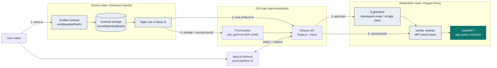
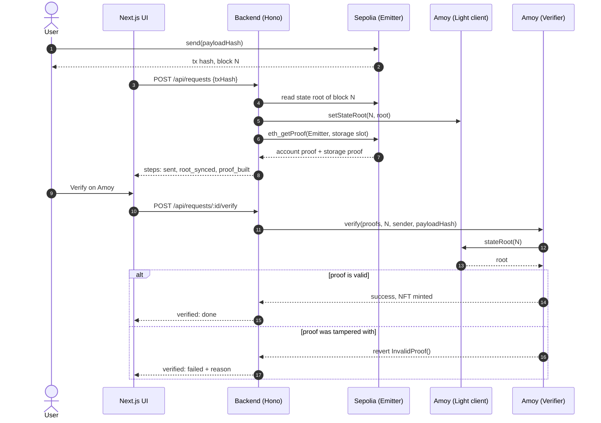
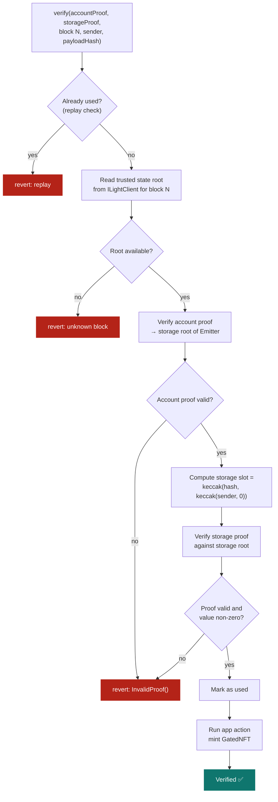
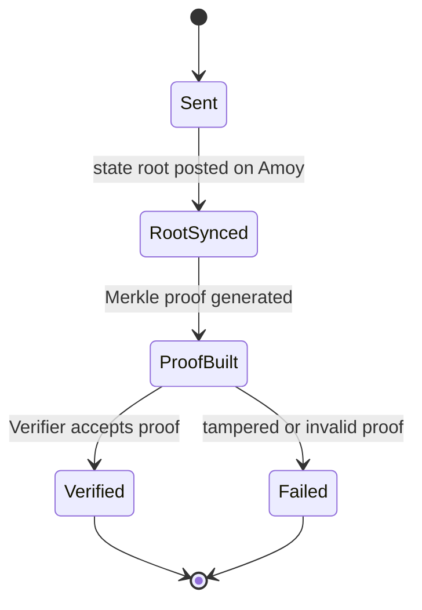

<p align="center">
  
</p>

<p align="center">
  <b>Prove a transaction on one blockchain. Use it on another. No bridge operator to trust.</b>
</p>

<p align="center">
  
  
  
  
  
  
  
  
</p>

<p align="center">
  <a href="https://team-genesis-rohan-tarke.vercel.app/">Live demo UI</a> ·
  <a href="#-the-problem">Problem</a> ·
  <a href="#-how-it-works">How it works</a> ·
  <a href="#-architecture">Architecture</a> ·
  <a href="#-smart-contracts">Contracts</a> ·
  <a href="#-getting-started">Getting started</a> ·
  <a href="#-security-model">Security</a> ·
  <a href="#-roadmap">Roadmap</a>
</p>

---

## 📌 Project status

| Component | Status |
|---|---|
| Smart contracts (`Emitter`, `Verifier`, `CheckpointLightClient`, `GatedNFT`) | Built. **10 Foundry tests passing.** |
| Merkle-Patricia verification against **real Sepolia data** | Tested (9 account-proof nodes and 6 storage-proof nodes captured from Sepolia) |
| Backend API, proof builder and relayer | Built, with unit and integration tests |
| Frontend (Next.js) | Built and deployed on Vercel |
| Live Sepolia → Amoy run with deployed contracts | **Next milestone.** Code paths exist; deployment needs funded testnet wallets |

The hosted UI at [proof-link-iota.vercel.app](https://team-genesis-rohan-tarke.vercel.app/) runs in **demo mode** (`NEXT_PUBLIC_MOCK=1`), which does not talk to a chain. The contract verification logic is what is tested on real proof data.

## 🚨 The problem

Blockchains such as Ethereum, Polygon, Solana and Avalanche each keep their own state, consensus and execution environment. A smart contract on one chain **cannot natively check** what happened on another.

Existing solutions rely on centralized bridges, external relayers, multisig wallets or intermediary networks. These add cost and delay, and every one of them is a single point of failure. In June 2022 the Horizon bridge lost about **$100M** after compromised keys on a small multisig.

Changing the core protocol of established blockchains to fix this is not practical.

**Goal:** let a user start a transaction on one chain and have another chain verify it directly, with no centralized intermediary and no changes to the underlying blockchain protocols.

## ✅ Our solution

ProofLink replaces trust in people with verification of math. The destination chain checks a cryptographic proof against a trusted state root of the source chain.

| Traditional bridge | ProofLink |
|---|---|
| Trust a multisig or relayer committee | Trust cryptographic proofs and the source chain's own state |
| A relayer can steal or censor | A relayer can only deliver data, not forge it |
| Keys are a single point of failure | No privileged keys in the proof path |
| Chain-specific trust assumptions | Pluggable light client interface (`ILightClient`) |

## ⚙️ How it works

1. **Send.** The user calls `Emitter.send(payloadHash)` on the source chain. The contract records `records[sender][payloadHash] = block.number` and emits `Sent(sender, payloadHash)`.
2. **Sync a trusted root.** The state root of the source block is made available on the destination chain through `ILightClient.stateRoot(sourceBlock)`.
3. **Build the proof.** The prover calls `eth_getProof` (EIP-1186) for the `Emitter` account and the storage slot of the record at that block.
4. **Verify on-chain.** `Verifier.verify(...)` checks the account proof against the state root, extracts the `Emitter`'s storage root, then checks the storage proof for the record's slot. A non-zero value means the transaction happened.
5. **Act.** On success, the app action runs (the demo mints a `GatedNFT`). Any tampered or invalid proof reverts with `InvalidProof()`.

Anyone can submit proofs. A fake proof simply fails the math.

## 🗺️ Architecture

> 🔍 **Zoom:** GitHub renders these diagrams with pan and zoom controls. Hover a diagram and use the **+ / −** buttons, or open the code in [mermaid.live](https://mermaid.live).

### System overview



### Request lifecycle



### Verification logic inside the `Verifier`



### Request states (as shown in the UI)



## 📜 Smart contracts

| Contract | Chain | Purpose |
|---|---|---|
| `Emitter.sol` | Source (Sepolia) | `send(bytes32 payloadHash)` stores `records[msg.sender][payloadHash] = block.number` (storage slot 0) and emits `Sent` |
| `ILightClient.sol` | Destination | Interface: `stateRoot(uint256 sourceBlock) returns (bytes32)`. The plug-in point for a zk light client |
| `CheckpointLightClient.sol` | Destination (Amoy) | Owner-restricted `setStateRoot`. Current trust root (see Security model) |
| `Verifier.sol` | Destination (Amoy) | Verifies account and storage proofs, enforces replay protection, reverts `InvalidProof()` on failure |
| `GatedNFT.sol` | Destination (Amoy) | ERC-721 minted by the `Verifier` after a successful verification (demo app action) |
| `MerklePatriciaProof.sol`, `RLPReader.sol` | Library | Merkle-Patricia Trie and RLP decoding, adapted from existing open-source libraries |

**Storage slot of a record** (mapping at slot 0):

```
inner = keccak256(abi.encode(sender, uint256(0)))
slot  = keccak256(abi.encode(payloadHash, inner))
```

## 🔌 Backend API

Default base URL: `http://localhost:4000`. Full contract in [`SPEC.md`](SPEC.md).

| Method | Route | Purpose |
|---|---|---|
| `POST` | `/api/requests` | Body `{ txHash, sourceChainId }`. Starts the pipeline, returns `{ id }` |
| `GET` | `/api/requests/:id` | Returns `{ id, steps[] }` with four steps in fixed order |
| `POST` | `/api/requests/:id/verify` | Body `{ tamper }`. Submits `Verifier.verify` on the destination chain. With `tamper: true` one byte of the proof is flipped to show rejection |
| `GET` | `/` | Health check: `{ status, mode }` |

Step keys, in order: `sent`, `root_synced`, `proof_built`, `verified`. States: `pending`, `active`, `done`, `failed`. Verification is blocked until `proof_built` is done.

### Backend modes

| Mode | How to select | Behavior |
|---|---|---|
| **Real** (default) | `SIMULATE` not set | Uses live RPC calls and real transactions. Refuses to start if an RPC URL, key or deployed address is missing or still a placeholder. Never falls back to fake data |
| **Local test** | `SIMULATE=1` | Used only by automated tests and local dry runs without funded wallets |

The startup log prints `MODE: REAL` or `MODE: SIMULATED`, and `GET /` reports the same.

## 🧰 Tech stack

| Layer | Technology | Purpose |
|---|---|---|
| Smart contracts | Solidity, Foundry | Contracts and tests |
| Standards | EIP-1186 (`eth_getProof`), Merkle-Patricia Trie, RLP, keccak256 | Proof construction and verification |
| Proof builder and relayer | TypeScript, Node.js, Hono, viem | Fetches proofs, posts roots, submits verification, serves the API |
| Frontend | Next.js 14, React 18, TypeScript, Tailwind CSS, viem | Wallet connect and live proof pipeline UI |
| Testing | Foundry, Node test runner (`tsx`) | Contract tests, API tests, end-to-end script |
| Infrastructure | Alchemy or Infura RPC, Vercel, GitHub | Chain access, hosting, version control |
| Planned | SP1 zkVM | zk-verified Ethereum light client |

## 📁 Project structure

```text
.
├─ app/                  Next.js app (UI)
├─ lib/                  API client (includes demo-mode data layer)
├─ assets/               logo
├─ contracts/
│  ├─ src/               Emitter, ILightClient, CheckpointLightClient,
│  │                     Verifier, GatedNFT, MerklePatriciaProof, RLPReader
│  └─ test/              ProofLink.t.sol + fixtures/sepolia_proof.json
├─ backend/
│  ├─ src/               index.ts, config.ts, proof.ts, relayer.ts
│  ├─ scripts/           deploy.ts, e2e.ts
│  └─ test/              api.test.ts
├─ SPEC.md               shared contract + REST specification
└─ README.md
```

## 🚀 Getting started

### Prerequisites
- Node.js 18.17 or newer
- [Foundry](https://book.getfoundry.sh/)
- For a live run: a wallet with Sepolia ETH and Amoy POL, plus Sepolia and Amoy RPC URLs

### 1. Run the contract tests

```bash
cd contracts
forge test -vv
```

You should see 10 passing tests, including `test_Verifier_RealSepoliaProof`.

### 2. Run the UI

```bash
npm install
npm run dev
```

Create `.env.local`:

```env
NEXT_PUBLIC_MOCK=1
NEXT_PUBLIC_API_URL=http://localhost:4000
NEXT_PUBLIC_EMITTER_ADDRESS=0x0000000000000000000000000000000000000000
```

Open <http://localhost:3000>. With `NEXT_PUBLIC_MOCK=1` the UI uses built-in demo data and needs no wallet or backend.

### 3. Run against live testnets

1. In `backend/`, copy `.env.example` to `.env` and fill `SEPOLIA_RPC`, `AMOY_RPC`, `DEPLOYER_KEY` and `RELAYER_KEY`. Use a throwaway testnet wallet. Never commit `.env`.
2. Deploy and start:

```bash
cd backend
npm install
npm run deploy      # writes deployments.json
npm run dev         # startup log must say MODE: REAL
```

3. In the frontend `.env.local`, set `NEXT_PUBLIC_MOCK=0`, `NEXT_PUBLIC_API_URL` and the deployed `NEXT_PUBLIC_EMITTER_ADDRESS`, then restart `npm run dev`.
4. Send a message, wait for the steps, click **Verify on Amoy**, and open the returned transaction hash on the Amoy explorer.

## 🧪 Testing

| Suite | Command | Covers |
|---|---|---|
| Contracts | `cd contracts && forge test` | Emitter, light client access control, valid proof passes and mints, tampered proof reverts, replay reverts, unknown block reverts, **real Sepolia proof** |
| Backend | `cd backend && npm test` | Health and mode, CORS, storage-slot calculation, proof tampering, request flow, verify blocked before `proof_built`, real mode does not treat any tx hash as a test |
| End to end | `cd backend && npm run e2e` | Contract checks plus the API pipeline (runs in local test mode) |

## 🔐 Security model

- **Trustless part:** the proof check. The `Verifier` validates account and storage proofs on-chain, so a relayer cannot fabricate a transaction.
- **Current limitation:** the light client runs in **checkpoint mode**. The source-chain state root is posted by an authorized account, so the correctness of the root is trusted today.
- **Production path:** replace the checkpoint with a zk-verified Ethereum light client (sync-committee proof) behind the same `ILightClient` interface. The `Verifier` does not change.
- **Replay protection:** each `(sender, payloadHash)` pair can be verified once.
- **RPC note:** standard RPC nodes serve `eth_getProof` only for recent blocks, so build the proof soon after the transaction.
- **Not audited.** This is a hackathon prototype. Do not use it with real funds.

## 📊 Comparison with existing approaches

| Approach | Trust assumption | Weakness |
|---|---|---|
| Multisig bridge | Majority of signers is honest | Key compromise (Horizon, Ronin) |
| Relayer / oracle network | Operators are honest | Extra intermediary, added cost |
| Optimistic bridge | A watcher will challenge fraud | Long waiting period |
| On-chain light client | Source consensus only | High gas cost |
| **ProofLink** | Source consensus and math (target design) | Proof generation takes minutes |

## 🛣️ Roadmap

- [x] Merkle-Patricia verifier and demo app contracts (EVM to EVM)
- [x] Foundry tests, including a real Sepolia proof
- [x] Backend API, proof builder and relayer
- [x] Proof pipeline UI with tamper test
- [ ] Live Sepolia → Amoy deployment and recorded run
- [ ] zk light client integration (SP1)
- [ ] More EVM chains, then non-EVM adapters (Solana, Avalanche)
- [ ] SDK to verify any event or storage value cross-chain

## 🙏 Acknowledgements and references

Built with ideas from [zkBridge](https://rdi.berkeley.edu/zkp-web3-hackathon/tracks/zk_bridge_track), Horizon, [Succinct Telepathy](https://docs.telepathy.xyz/protocol/proof-of-consensus), [proveth](https://github.com/lorenzb/proveth), IBC and Rainbow Bridge.


## 📄 License

MIT
